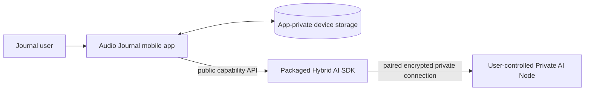
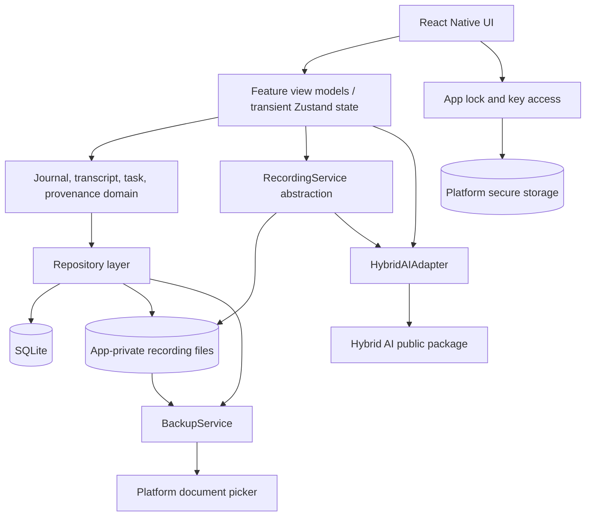

# High-Level Design

**Status:** Target v0.1 design; implementation has not started.

## 1. Architecture principles

1. Journal first, AI second.
2. Source data is immutable with traceable derivations.
3. Local capture must survive AI, network, and process failures.
4. Security and unlock are local and independent from Hybrid AI.
5. Journal-specific logic stays above the product-neutral SDK.

## 2. System context



There is no account service, public cloud AI endpoint, relay, or hosted journal
database in v0.1. The node is optional; core journal behavior remains local.

## 3. Mobile application containers



## 4. Component responsibilities

### UI and feature layer

- Onboarding/lock, Today/timeline, recorder, entry detail, playback, organized
  views/tasks, node settings, privacy settings, and developer diagnostics.
- Never treats transient state as durable source data.

### Domain layer

- Entry and recording lifecycle.
- Transcript segment revision/finalization.
- Derived artifact/task validation and provenance.
- Rules preventing source mutation by AI output.

### Persistence layer

- Transactional SQLite repositories for structured data.
- App-private file management for recordings.
- Migration, deletion, and startup reconciliation boundaries.
- Encryption mechanics are blocked on the open security ADR.

### Recording service

- Native-capable audio capture, pause/resume, sample levels, frame delivery,
  interruption response, and safe file finalization.
- Continues capture when transcription is unavailable.

### Security layer

- Lock lifecycle and auto-lock policy.
- PIN verifier/key-unlock flow and optional OS biometric prompt.
- Secure-storage adapter and fail-closed behavior.
- Does not receive raw biometric material.

### Hybrid AI adapter

- Converts app domain requests into public SDK capability calls.
- Separates provisional transcription streams from persisted finalized segments.
- Validates application-owned organization results before domain persistence.
- Maps SDK target/status/error events into user-appropriate app states.

### Backup service

- Creates one consistent encrypted snapshot of structured data and recordings.
- Streams large data with bounded memory and no plaintext archive staging.
- Uses the platform document picker for user-controlled destination/source files.
- Authenticates, versions, checksums, previews, stages, and atomically activates restore.
- Excludes app-lock/biometric keys and Private AI Node pairing credentials.

## 5. Primary flows

### Recording and live transcript

1. Create draft entry/recording IDs and target file.
2. Start durable audio writer.
3. Mark recording state active transactionally.
4. Offer copied/bounded audio frames to Hybrid AI transcription.
5. Render provisional segments; persist only normalized segment updates.
6. On finish, finalize audio first, then finalize transcript state.
7. If STT fails, record the failure state and keep the playable entry.

### Explicit organization

1. User selects content and invokes Organize.
2. App resolves finalized transcript text and provenance references.
3. App calls the application-owned `journal.organize@1` contract through SDK.
4. SDK routes according to `local | node | auto` and app policy.
5. App validates the terminal result and writes a derivation revision plus
   provenance links in one transaction.
6. Failure/cancellation writes no partial derived artifact and changes no source.

### Local unlock

1. App launches into a content-obscuring locked shell.
2. Security layer obtains PIN verification or an OS biometric result.
3. It releases the local data-access key/session on success.
4. Repositories and protected navigation become available.
5. Lifecycle policy clears the session key and obscures content on relock.

### Backup and restore

1. User supplies a portable backup password/recovery key and chooses Create backup.
2. Backup service freezes a logical snapshot, streams database/domain records and
   referenced recordings into an authenticated encrypted archive, then verifies it.
3. Platform picker saves the completed archive to the user's chosen destination.
4. On an empty install, user creates a new local PIN and selects Restore backup.
5. Backup service authenticates and validates the archive, previews counts/size,
   restores into staging, verifies, and atomically activates the recovered vault.
6. Biometrics and node pairing are configured again rather than restored.

## 6. Trust boundaries

- **Device UI boundary:** locked screens must not reveal entries in snapshots,
  widgets, notifications, recent-search suggestions, or accessibility labels.
- **Secure storage boundary:** key material and credential verifiers stay behind
  Keychain/Keystore-backed abstractions.
- **SDK boundary:** only public SDK types/contracts are visible to the app.
- **Private network boundary:** node traffic relies on SDK pairing/authentication;
  LAN discovery alone grants no trust.

## 7. Failure principles

- Source persistence outranks transcript freshness and AI progress.
- No automatic public-cloud fallback.
- Invalid AI output is rejected before persistence.
- After partial node output, the app does not silently change execution target.
- Database/file mismatches enter reconciliation; they are not silently deleted.
- A missing/inaccessible secure key fails closed and offers documented local reset,
  not account recovery.

## 8. Planned repository shape

```text
audio-journal/
├── src/
│   ├── app/
│   ├── features/{lock,today,recorder,diary,tasks,playback,settings}/
│   ├── domain/{journal,transcript,tasks,provenance}/
│   ├── data/{database,repositories,files}/
│   ├── ai/capabilities/
│   ├── security/
│   └── native/recording/
├── android/
├── ios/
├── tests/
└── docs/
```
