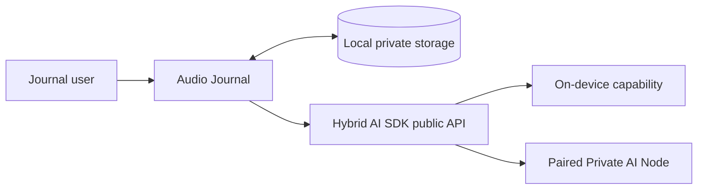
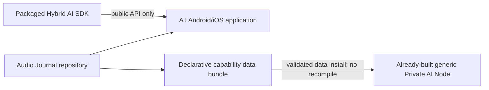
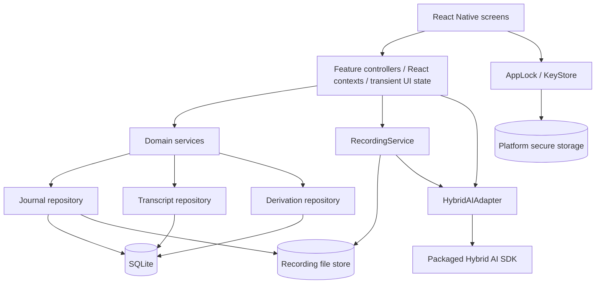
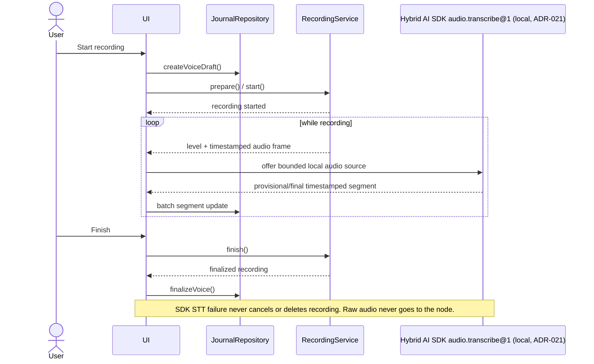
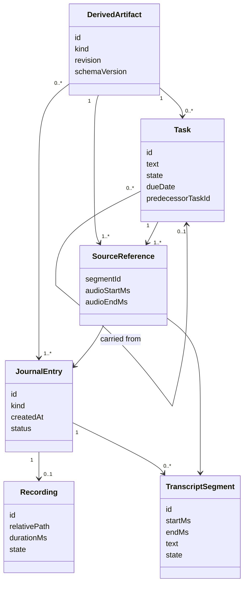
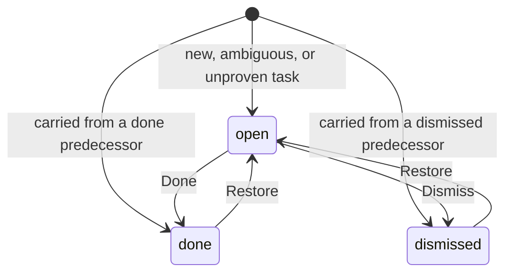
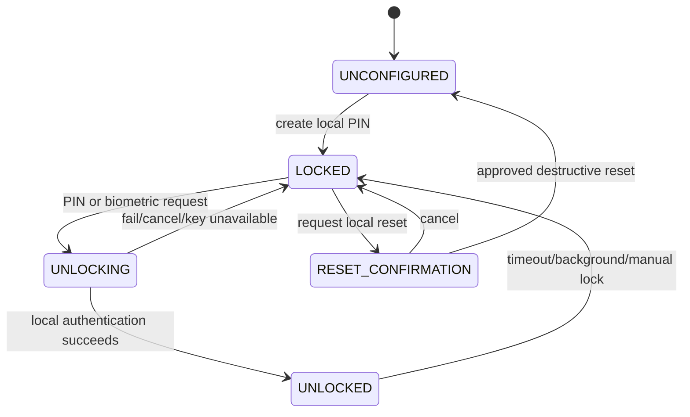
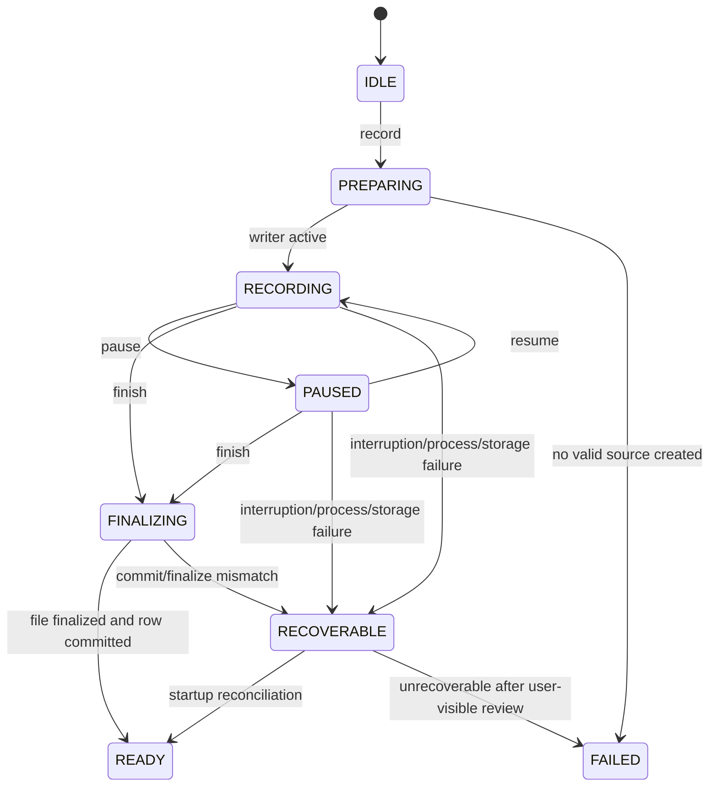
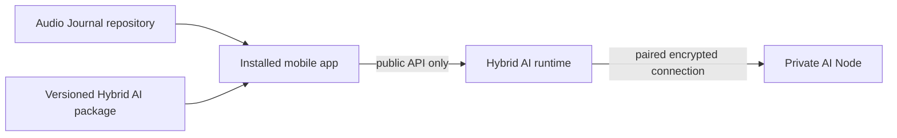

# UML and Behavioral Diagrams

## 1. System context



The node is the external SDK-owned native `private-ai-node` product on Linux,
Windows, or macOS. Its service, networking, TLS, model host, operator CLI, and
platform adapters are intentionally outside the AJ component boundary and are
diagrammed in `hybridAi/docs/uml-diagrams.md` §4a–4b.



## 2. Component diagram



## 3. Recording and transcription sequence



## 4. Organization sequence

```mermaid
sequenceDiagram
    actor User
    participant UI
    participant Repo as Repositories
    participant AI as HybridAIAdapter
    participant SDK as Hybrid AI SDK
    participant Local as SDK local model
    participant Tailnet as Tailscale (direct or relay)
    participant Node as Generic Private AI Node model

    User->>UI: Organize selected entry/range
    UI->>Repo: load finalized transcript + source refs
    UI->>AI: organize(validated selection)
    AI->>SDK: journal.organize@1 via public API, explicit local or node
    alt local
        SDK->>Local: validated capability package + text/provenance
        Local-->>SDK: real structured model events/result
    else node
        SDK->>Tailnet: paired mTLS request to configured endpoint
        Tailnet->>Node: text/provenance only
        Node-->>Tailnet: real structured model events/result
        Tailnet-->>SDK: unchanged encrypted stream
    end
    SDK-->>AI: events
    AI-->>UI: safe progress only
    SDK-->>AI: terminal result
    AI->>AI: schema + bounds + provenance validation
    alt valid
        AI->>Repo: atomic derivation revision
        Repo-->>UI: organized view/tasks
    else invalid, failed, or cancelled
        AI-->>UI: retryable error; source unchanged
    end
```

### 4a. AJ-RI-3 explicit-local organization (ADR-023)

```mermaid
sequenceDiagram
    participant U as User
    participant AJ as Audio Journal
    participant SDK as Packaged Hybrid AI SDK
    participant M as SDK llama.cpp Provider

    U->>AJ: choose entries + Local + consent
    AJ->>SDK: journal.organize@1 (exact contract input)
    SDK->>M: exact package/profile under lease
    M-->>SDK: buffered grammar-constrained JSON
    SDK-->>AJ: completed only after structural validation
    AJ->>AJ: resultViolation + semantic/provenance checks
    alt all checks pass
        AJ-->>U: persist and show Organized/Tasks
    else any check fails
        AJ-->>U: typed no-result state; source unchanged
    end
```

No token stream or partial JSON is persisted. `aj.rules` is not on this
production path.

## 5. Source and derivation model



### Task state (ADR-020)



A task's text, due date, and predecessor never change; only its state does.
A reorganize adds a new revision and leaves earlier task rows unchanged.

## 6. App-lock state



## 7. Recording state



## 8. Deployment boundary



## 9. Backup and restore sequence

```mermaid
sequenceDiagram
    actor User
    participant UI as Backup & restore UI
    participant Backup as BackupService
    participant Store as Database + recordings
    participant Picker as OS document picker

    User->>UI: Create backup
    UI->>Backup: create(strong portable secret)
    Backup->>Store: consistent snapshot + referenced files
    Store-->>Backup: bounded record/file streams
    Backup->>Backup: authenticated encrypt + finalize
    Backup->>Backup: reopen, authenticate, verify checksums
    Backup->>Picker: save verified .ajbackup
    Picker-->>User: user-controlled destination

    Note over User,Picker: Later, after app data is cleared or on an empty install

    User->>UI: Restore backup
    UI->>Picker: select .ajbackup
    Picker-->>Backup: user-selected archive
    UI->>Backup: inspect(secret)
    Backup->>Backup: authenticate + validate version/bounds/checksums
    Backup-->>UI: preview date, counts, size
    User->>UI: Confirm restore
    UI->>Backup: restore into staging vault
    Backup->>Backup: validate DB/files/provenance
    Backup->>Store: atomic activation
    Backup-->>UI: restored; re-enable biometrics and re-pair node
```
